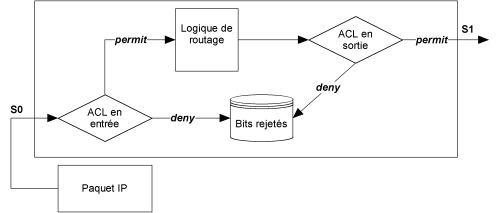

# Les ACL sur les équipements Cisco

## 1. Explications sur les ACL Cisco (access control list)

Les ACL permettent de filtrer les accès entre les différents réseaux ou de filtrer les accès au routeur lui même.
Les paramètres controlés sont:

* Adresse IP source
* Adresse IP de destination
* Protocole utilisé (ICMP, TPC, UDP, IPSEC)
* Numéros de port source et destination

Les ACL peuvent être appliquées sur le trafic entrant ou sortant. Il y a deux actions: 

* soit le trafic est interdit, 
* soit le trafic est autorisé.. 

!!! Warning  "Attention"
    Les ACL sont prises en compte de façon séquentielle. Il faut donc placer les instructions les plus précises en premier et l'instruction la plus générique en dernier. Une fois une ACL générée, une règle implicite finale est appliquée et elle interdit tout le trafic.

Voici un schéma permettant de définir les différentes étapes lors de l'utilisation d'ACL sur une interface :


    
## 2. Différence entre les ACL standards et étendues

L'ACL standard filtre uniquement à partir des adresses IP sources. Elle est de la forme:

* _access-list numéro-de-la-liste {permit|deny} {host|source source-wildcard|any}_

Le numéro de l'ACL standard est compris entre 1 et 99.

L'ACL étendue filtre sur les adresses IP source et destination, sur le protocole et les numéros de port. Elle est de la forme:

* _access-list numéro de la liste {deny|permit} protocole source masque-source [operateur [port]] destination masque-destination [operateur [port]][established][log]_

Quelques opérateurs:
* eq : égal
* neq : différent
* gt : plus grand que
* lt : moins grand que

Le numéro de l'ACL étendue est compris entre 100 et 199.

Il est possible de nommer les ACL. Dans ce cas, on précisera dans la commande si ce sont des acls standards ou étendues.

```bash
(config)#ip access-list standard ACL_NAT
```

```bash
(config)#ip access-list extended ACL_VLAN_Admin
```

## 2.Notion de masque générique (wildcard mask)

Les ACL utilisent un masque permettant de sélectionner des plages d'adresses.

**Fonctionnement:**

En binaire, seuls les bits de l'adresse qui correspondent au bit à 0 du masque sont vérifiés. Par exemple, avec 172.16.2.0 0.0.255.255, la partie vérifiée par le routeur sera 172.16.

Sur le couple suivant: 0.0.0.0 0.0.0.0, toutes les adresses sont concernées (any). Sur ce couple: 192.168.2.3 255.255.255.255, on vérifie uniquement l'hote ayant l'IP 192.168.2.3 (host)

**Exemple** : Le masque 255.255.255.128 donnera comme wildcard mask 0.0.0.127

## 3. Comment appliquer les ACL ?

On crée l'ACL puis ensuite on applique l'ACL à une interface en entrée ou en sortie (in ou out).

Si l'ACL doit être mofifiée, il sera nécessaire de supprimer celle-ci puis de la recréer entièrement. Une façon pratique de faire est de conserver l'acl dans un fichier texte puis de faire un copier/coller.

```bash
(config)#int Gig0/0
(config-subif)#ip access-group IPv4_LAN in
```

## 4. Mise en place des ACL Cisco sur un routeur ou commutateur layer 3


**Création d’une ACL standard**

```bash
Router(config)# access-list numéro-liste-accès {deny|permit} adresse-source [masque-source] [log]
```

**Création d’une ACL étendue**

```bash
Router(config)# access-list numéro-liste-accès {deny|permit} protocole adresse-source masque-source [opérateur port] adresse-destination masque-destination [opérateur port] [log]
```

Où protocole (IPv4) peut être :


- <0-255> An IP protocol number

- ahp Authentication Header Protocol

- eigrp Cisco’s EIGRP routing protocol

- esp Encapsulation Security Payload

- gre Cisco’s GRE tunneling

- icmp Internet Control Message Protocol

- igmp Internet Gateway Message Protocol

- ip Any Internet Protocol

- ipinip IP in IP tunneling

- ospf OSPF routing protocol

- tcp Transmission Control Protocol

- udp User Datagram Protocol


Où l’opérateur peut prendre les valeurs suivantes :


- lt (less than) : “moins que”.

- gt (greater than) : “plus que”.

- eq (equal) : “égal à”.

- neq (not equal) : “non équivalent”.

- range (inclusive range) : “étendue d’une plage”.


Où le paramètre “port” peut prendre une valeur nominative ou numéraire : de 0 à 65535 ou, par exemple, www, telnet, ftp, etc.


**Les ACL nommées**


Les ACLs nommées se distinguent par un nom. Il faut spécifier le type standard ou extended en IPv4. Les ACLs IPv6 sont d’office “extended” de telle sorte que le paramètre disparaît des commandes. Les règles s’incrémentent d’un numéro d’ordre (tous les 10). Cet ID permet d’insérer des règles dans une liste.

```bash
(config)# ip access-list standard ACL_IPv4_STD
(config-std-nacl)#permit | deny ?
(config)#exit
```

Par exemple

```bash
(config)# ip access-list extended IPv4_LAN
(config-ext-nacl)#
permit tcp 192.0.2 0.0.0.255 any eq 80
permit tcp 192.0.2.0 0.0.0.255 any eq 443
```

!!! Warning  "Attention"
    **Attention !** Lorsque l’on génère des ACL, il est obligatoire de fournir un masque générique (wildcard mask ou masque de filtrage) et non un masque de sous-réseau. On parle aussi de masque inversé.


Exemple :

Pour un masque de sous-réseau 255.255.255.0, le masque générique attendu sera 0.0.0.255


**Visualiser les ACL déjà présentes**

```bash
Router# show access-lists
```

**Application des ACL**


Une ACL une fois créée s’applique sur une interface en entrée ou en sortie.

```bash
Router(config)# int g0/0
Router(config-if)#ip access-group IPv4_LAN in|out
```

**Suivi de l’état des connexions**


**Attention !** Le filtrage avec les ACL sur un équipement Cisco n’est pas stateful. Ainsi, il faudra s’assurer que les réponses à une connexion préalablement établie soient bien autorisées sur les interfaces correspondantes.

```bash
(config)# ip access-list extended IPv4_SERVEURS
(config-ext-nacl)#
permit tcp any any established
permit udp host 192.0.2.50 eq 53 any
permit icmp any any echo-reply
```

**Affichage de la liste de contrôle :**

```bash
R2#show access-lists reseau-secretariat
Extended IP access list reseau-secretariat
10 permit tcp host 192.168.2.1 gt 1023 192.168.3.0 0.0.0.255 eq 22
20 permit tcp any any established
30 deny ip any any log
R2#
```

**Suppression d'une acl :**

```bash
R2(config)#no ip access-list extended reseau-secretariat
R2(config)#end
```

**Suppression de l'association de la liste de contrôle à une interface :**

```bash
R2(config)#int fa1/1
R2(config-if)#no ip access-group reseau-secretariat out
R2(config-if)#
```

## 5. Gestion de l'ordre de priorité des règles dans une ACL

??? Warning "Attention"
    Comme dans tout système de filtrage, l'ordre des règles est primordial. Sur les équipements Cisco, les 1ères règles définies dans une ACL prendront le pas sur les suivantes exactement comme dans un tableau ou une matrice réalisés en amont.

Pour faciliter la gestion et la mise à jour de vos règles dans le routeur ou le commutateur de niveau 3, il est recommandé de fournir un numéro de séquence compris entre 1 et 2147483647 avant la directive permit ou deny afin d'améliorer l'ordonnancement. Cela vous permettra notamment d'ajouter facilement une règle à la position voulue sans devoir tout reprendre.

**Exemple**

```bash
SW-CORE(config)#ip access-list extended ACL-TEST
SW-CORE(config-ext-nacl)#10 deny udp 10.10.10.0 0.0.0.255 10.10.20.0 0.0.0.255 log
SW-CORE(config-ext-nacl)#20 deny icmp 192.168.1.0 0.0.0.255 any log
SW-CORE(config-ext-nacl)#30 deny tcp 172.16.1.0 0.0.0.255 any eq telnet log
SW-CORE(config-ext-nacl)#1000 permit ip any any
SW-CORE(config-ext-nacl)#end
```

Si vous souhaitez positionner une nouvelle règle avant le permit ip any any, vous pouvez le faire facilement à l'aide du numéro de séquence :

```bash
SW-CORE(config-ext-nacl)#40 deny ip 192.168.10.0 0.0.0.255 any log
```

Ainsi, pensez à systématiquement utiliser ce numéro de séquence lors de la création de vos règles dans vos ACL.